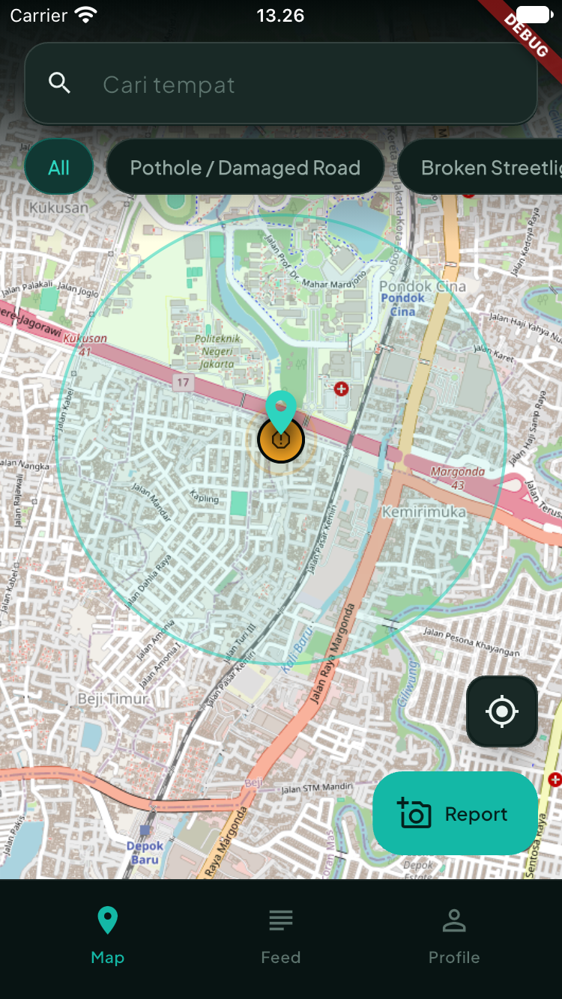
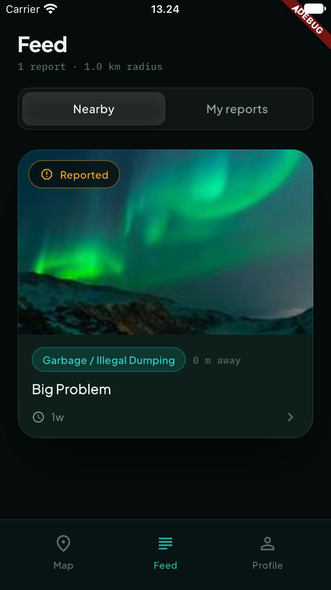
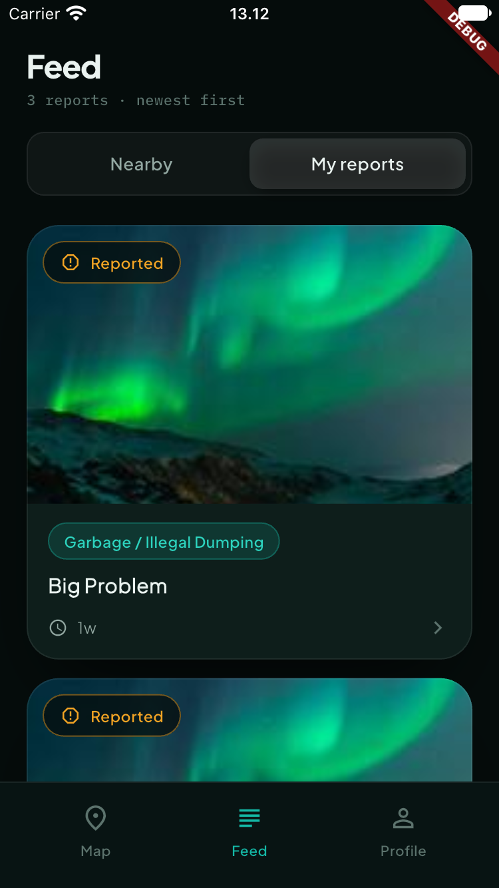
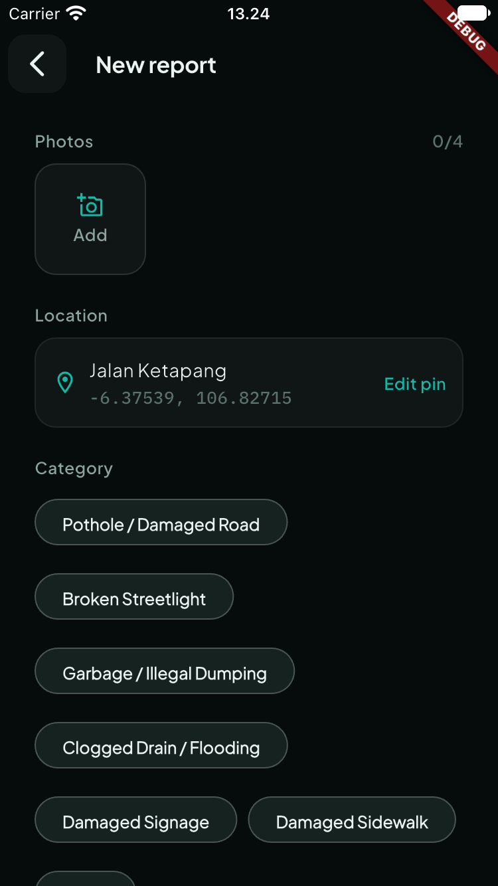
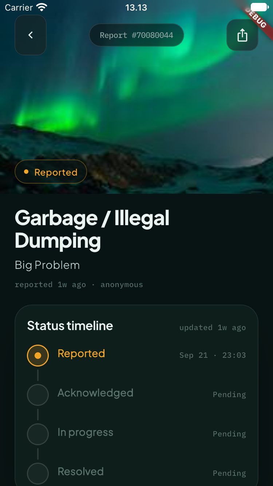
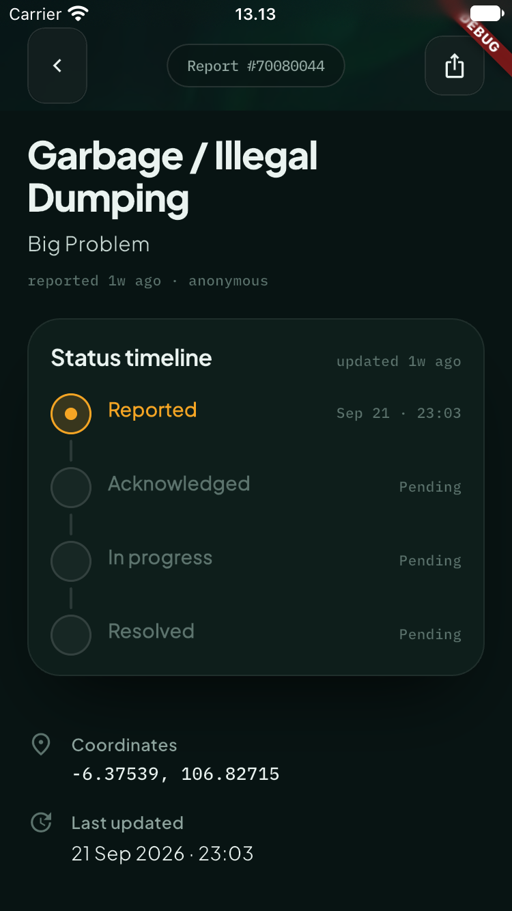

# Pantau

Pantau is a civic issue reporting project. Residents submit reports with a location and photos, see nearby reports on a map or in a feed, and follow each report's status. Resolvers work through a queue of nearby reports and move them from `reported` to `resolved`, or reject them with a note.

## App showcase

Explore nearby issues, submit a report, and follow its progress.

| Nearby map | Nearby feed | My reports |
| :---: | :---: | :---: |
|  |  |  |

| Create a report | Report details | Status timeline |
| :---: | :---: | :---: |
|  |  |  |

[View all 19 screenshots](docs/screenshots), including onboarding, authentication, location selection, and profile screens.

## Project structure

This repository contains two applications:

| Directory | Application | Stack |
| --- | --- | --- |
| [`frontend/`](frontend/README.md) | Mobile app | Flutter, Riverpod, `flutter_map` (OpenStreetMap) |
| [`backend/`](backend/README.md) | REST API | Go (Fiber, Fx, GORM), PostgreSQL with PostGIS, MinIO |

The applications keep their own dependencies, tests, and setup instructions. There is no root-level build command.

## Run locally

You need Docker with Compose v2, Go 1.27.1, and Flutter 3.47 or later.

1. Configure and start the backend's database and object storage:

   ```sh
   cd backend
   cp .env.example .env   # then replace the passwords, MinIO keys, and JWT secret
   docker compose -f docker-compose.dev.yml up -d migrate minio-init
   ```

   This starts PostgreSQL/PostGIS and MinIO on `127.0.0.1`, applies the SQL migrations, and creates the photo bucket. See the [backend guide](backend/README.md#run-locally) to use your own PostgreSQL and MinIO instead, or to run the API in a container too.

2. Start the API from `backend/`:

   ```sh
   go run ./cmd/api
   ```

   It listens on port `8080` and serves routes under `/api/v1`.

3. In another terminal, start the mobile app:

   ```sh
   cd frontend
   flutter pub get
   dart run build_runner build --delete-conflicting-outputs
   flutter run
   ```

The app connects to the local API on port `8080`. It uses `10.0.2.2` on an Android emulator and `127.0.0.1` on other targets. For a physical device, change the address in [`api_endpoints.dart`](frontend/lib/core/network/api_endpoints.dart) to one it can reach. Photos load from the backend's `MINIO_PUBLIC_URL`, so set it to an address the device can reach as well (for example `http://10.0.2.2:9000` on an Android emulator); see [Image URLs](backend/README.md#image-urls-minio_public_url).

New accounts are citizens. To try the resolver side, promote an account in the database as described in [Resolver accounts](backend/README.md#resolver-accounts).

## Tests

Run each suite from its application directory:

```sh
(cd backend && go test ./...)
(cd frontend && flutter test)
```

## Deployment

The backend ships as a distroless Docker image. `backend/docker-compose.prod.yml` is a Dokploy stack that runs the API, PostgreSQL, MinIO, and the migration and setup jobs behind Traefik; see [Run with Docker](backend/README.md#run-with-docker).

## Repository history

The Flutter and Go projects were developed separately and imported into this repository under `frontend/` and `backend/` using Git subtree. Their Git history is preserved in the monorepo.
